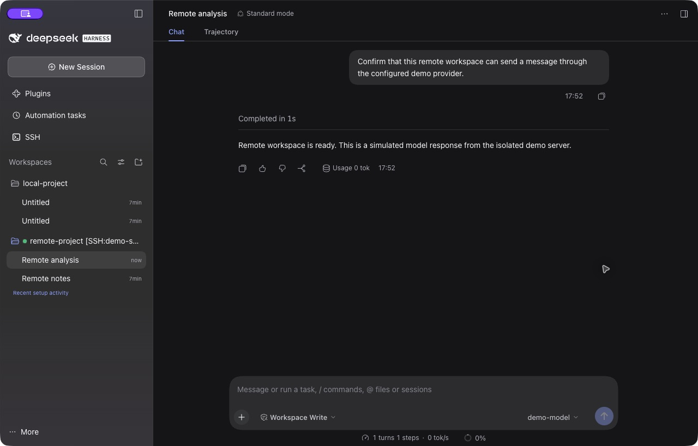
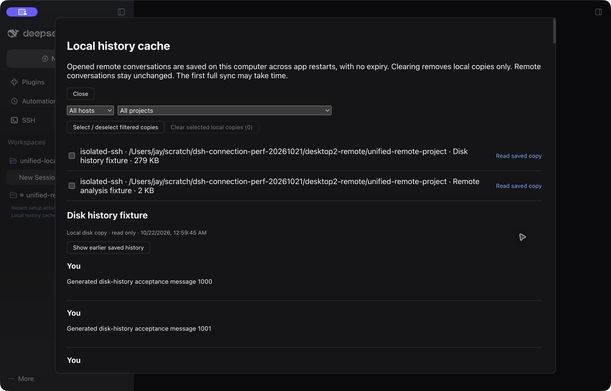

# DSH SSH Ops

**在 DeepSeek Harness 的同一侧栏中管理本地与 SSH 远端项目、切换会话，在当前窗口继续工作。**

远端工作区把 Agent、文件、终端、插件和会话放在远端机器运行。本机提供统一入口；你也可以只使用 SSH 面板完成终端操作、文件传输和端口转发。

适用于已经使用 DeepSeek Harness（DSH）、需要操作 Linux 或 macOS 服务器的用户。第三方插件，Apache-2.0。

[安装与首次使用](#安装与首次使用) · [本机历史缓存](#本机历史缓存) · [已验证的表现](#已验证的表现) · [兼容版本](#兼容版本) · [详细验收记录](docs/verification.md)

`0.3.24-jay.66` 汇总远端模型与插件跟随、账户服务复用、加载与缓存优化、项目排序和原生会话操作。RC2/RC3 的父窗口快捷键会跟随当前远端会话，保留本地原生操作及用户按键设置。



真实隔离演示：左侧同时显示本地项目和 `demo-server` 远端项目，右侧是远端会话。图中回复来自模拟模型服务，用于验证配置与消息链路，不代表模型效果或速度。[截图环境与复现步骤](docs/onboarding.md)。

## 你能用它做什么

| 你的目标 | 使用入口 | 得到的结果 |
| --- | --- | --- |
| 在服务器项目上使用完整 DSH | **Add workspace → SSH workspace** | 远端项目与会话进入本地侧栏，点击后在当前窗口打开；切换会话保留各自未发送的草稿 |
| 重启或断线后阅读远端聊天历史 | 侧栏 **本机历史缓存**，或已保存的远端会话 | 历史写入本机磁盘，不自动过期；可按主机、项目、会话选择清除 |
| 直接运维服务器 | 左侧 **SSH** | 管理主机、打开多个终端、SFTP 上传/下载文件、转发端口、集群执行 |
| 让 Agent 操作已配置的服务器 | 六个 `ssh_*` 工具 | 查询主机、执行命令、上传/下载、管理隧道和集群执行 |

**远端模型可跟随本机，也可单独设置。** API 配置、受支持的凭据及默认模型按已选择的跟随策略同步；网页登录授权和本机回环代理不会直接复制。会话仍归所属主机管理。

## 项目拖动排序

统一侧栏支持拖动本地与 SSH 项目，既可在远端项目之间换位，也可与本地项目混排。顺序作为当前浏览器或桌面客户端的显示偏好保存，刷新后保留；其他客户端保留各自的显示偏好。新项目追加到已有排序之后，暂未加载的远端项目恢复后仍保留已保存的位置。

排序只调整侧栏显示，不修改项目目录、会话归属或远端数据。重命名、删除等项目操作仍按原来的主机归属保护。浏览器无法保存偏好时，本次布局仍可使用，并明确提示刷新后可能恢复。

## 服务器模型

SSH 工作区默认自动跟随本机的 API 模型配置和密钥。首次连接后同步，本机修改提供商、模型列表或 API Key 后自动更新；后台同步只使用已连接的主机，不会为了同步逐台建立 SSH 连接。默认模型也可以跟随本机，远端已有认证和单独选择的默认模型会优先保留。

在 **SSH → 服务器模型** 选择主机，可将整台主机或单个提供商切为 **独立配置**，再通过 **打开远端工作区 → 设置 → 模型** 单独编辑。也可以在连接前先关闭跟随。本机后续修改不覆盖独立项；远端手动修改过的提供商配置或密钥会自动保留为独立。明确切回 **跟随本机** 时，再使用本机配置更新对应提供商。其他远端提供商、会话和插件配置保留；本机移除整个提供商时不自动删除远端配置。

同步通过原生模型注册、设置与凭据服务完成，支持 API Key 引用和原生 API Key 记录，包括 DS 官方 API、OpenCode Go 和自定义 API。接口地址、协议、模型参数和必要请求头一起同步；网页登录授权、Cookie 和本机回环代理不会直接复制。同步成功表示配置已保存，不代表付费模型请求已实际通过。

远端通过官方插件渠道加载随安装包提供的轻量同步组件；安装使用私有目录的固定版本 pnpm，再通过原生插件服务启用，不依赖远端全局 pnpm 或本机继续在线。新旧密钥引用隔离，密钥值不返回浏览器、不进入同步回执或日志。同步状态使用私有原子文件持久化；断线后核对回执，不重复发送已经派发但结果不明的操作。原有远端 DSH 不会被强制重启；需要正常重启才能启用组件时，页面明确显示。缺少兼容原生接口的旧版本保留原配置并显示未支持。

## 服务器插件

在 **SSH → 服务器插件** 中，先打开目标服务器的一个 SSH 工作区，再选择服务器并点击 **对比插件**。页面显示本机与远端版本、是否缺失和 DSH 兼容性；默认不勾选插件，内置插件可单独展开。只有选中的公开 npm 精确版本会同步，本地开发链接、未发布和不兼容版本会说明原因并禁止同步。

同步使用远端官方 DSH CLI，缺少包管理器时在 DSH 私有目录准备固定版本 pnpm，不安装全局工具。已有插件的启用状态保持不变；不会复制本机模型、凭据、插件配置，或删除远端独有插件。安装结果会重新核对版本，需要重启时提示用户保存工作后处理。断线后不重复派发安装，结果不确定时保留私有回执与锁。

共享 DSH 服务从自己的数据目录启动，项目 `.env` 中的代理变量不再阻断整台服务器的服务启动。此功能包含在本版本中，连接时自动复用默认账户环境。

## 账号默认环境

同一机器、同一账号的终端和 SSH 复用默认 `~/.dsh` 与同一个常驻 Web 服务。兼容路径 `~/.local/share/dsh-remote/data` 指向同一份实际数据；运行 `dsh web` 会复用现有服务，避免重复占用端口。

使用 `dsh service status` 查看服务，`stop` / `restart` 会先检查 Agent 和终端活动。有工作时保留进程。明确设置其他 `DSH_HOME` 的研究或测试环境继续独立，Desktop、Web 和 Headless 的原生 profile 保留。

后续 SSH 连接会部署随插件提供的兼容服务管理组件，保留账号现用的 DSH 核心版本。若发现两份不同的已有默认数据目录，会拒绝覆盖，先备份合并。认证回执和日志为私有文件，不应分享。

## 远端界面加载

远端网关允许有限的 64 KiB 请求头，兼容浏览器在不同本机端口上积累的 DSH 登录 Cookie 和原生批量插件地址，避免批量加载被拒后回退到逐个下载。

远端明确标记为公开、不可变、带版本的 JavaScript/CSS 会保存在本机私有磁盘缓存，按 SSH 主机、DSH 版本和压缩格式隔离；更换窗口或网关端口后可继续复用。单份最多 12 MiB，总量按 64 MiB 回收旧副本。缓存损坏或不可写时正常从远端读取。聊天历史使用原有独立缓存，HTML、登录票据、API/模型列表、用户文件不进入代码缓存。

首次没有缓存时，远端 Node 会先把原生账户设置脚本中的大 PNG 插图改为按需读取，再压缩传输代码；打开账户设置时仍可显示原始插图。此步骤只读现有原生资源，不修改远端核心、插件文件或服务。

模型列表的 HTTP 只读请求超过 15 秒会明确失败，原生模型菜单提供重试入口；已提交任务不会因此重发。详见 [加载性能说明](docs/loading-performance.md)。

## 原生会话操作与快捷键

远端会话复用当前 DSH 注册的置顶、重命名、分支、归档/恢复、复制 ID 与确认表单。归档可恢复，并提供撤销提示。首次连接不再把侧栏焦点移到页底；未连接时，菜单提供只连接主机的入口，不自动新建会话。

在 DSH `0.2.1-rc.2` / `0.2.1-rc.3` 中，父窗口的新建、重命名、分支和归档快捷键指向当前远端主机；切回本地后沿用官方行为。当前官方接口尚无目标委托，因此本版本使用经过精确实现指纹核验的临时注册器适配层，不修改核心文件或用户按键配置。实现变化时隐藏嵌入视图并保留草稿，避免将操作发给停放的本地会话。该层与正常 Cordis 注册/卸载共存，不承诺隔离其他插件直接篡改私有注册器的行为。

其他已验证运行时可使用 SSH 运维功能和 Web 独立远端界面；其桌面嵌入不在本次快捷键适配范围内。详见[适配边界](docs/native-session-adapter-2026-10-29.md)。

## 安装与首次使用

以下流程面向 **DSH 桌面版 `0.2.1-rc.3`**。当前发布版本为 **`0.3.24-jay.66`**。远端自动安装支持 **Linux / macOS（x64、arm64）**；Windows 远端不在自动安装范围内。

### 1. 安装插件

打开 DSH **插件 → 添加插件**，填入：

```text
@biogod/dsh-ssh@0.3.24-jay.66
```

选择 **npm 官方源** 或 **中国大陆镜像源**，点击 **安装 → 立即启用**。按界面提示重启后，左侧应出现 **SSH**。

**更新已有桌面安装时，请先保存草稿，再完全退出并重新打开 DSH。** 后端可能缓存旧模块，刷新页面或重新启用插件不能代替重启。退出会断开本机持有的 SSH 运维终端；主机配置和已记住的密码保留。

### 2. 配置并信任主机

打开 **SSH → Hosts**，添加主机或导入 `~/.ssh/config`，检查地址、账号、认证方式和跳板设置。

首次连接前，通过可信渠道核对目标及每层跳板机的指纹，再由 OpenSSH 建立 `known_hosts` 信任。本插件会拒绝未知、变化或吊销的密钥，不会自动接受。

若此前没有连接过，请先在系统终端使用相同 SSH 配置登录一次，例如 `ssh your-host-alias`（替换为你的主机别名），按已核对的指纹建立信任；跳板机也需分别核对。插件内没有代你接受未知指纹的弹窗。

若系统 Terminal 能免密码登录，在主机 **Edit → Key** 中选择同一私钥，或使用 **SSH Agent**；插件不会自动读取 Terminal 已解锁的 macOS 钥匙串。

### 3. 打开远端项目

选择 **Add workspace → SSH workspace**，搜索并选择主机，填入远端项目目录，点击 **Connect and add**。

首次准备会显示检查、安装和启动进度，也可留在后台准备。安装缺失组件时，远端需要能下载 Node、DSH 和运行依赖；已有兼容安装会复用。成功后，远端项目与会话出现在统一侧栏，点击即可在当前窗口切换。

<details>
<summary>查看实际添加 SSH 工作区的界面</summary>


</details>

### 4. 开始首次对话

可先在 **SSH → 服务器模型** 查看同步状态。以下手动配置步骤适用于选择了独立配置、认证方式无法同步，或使用尚未支持自动同步的旧版本时。

1. 点击侧栏中的远端会话。首次启动若出现 **Get started**，使用官方 DeepSeek API 可选择 **Add API Key → Save and continue**，然后直接到第 4 项选择模型并发送消息；使用其他提供方可先选择 **Configure later**，继续以下配置。
2. 若需添加或修改模型，**macOS：先点击远端聊天输入框，再按 `⌘⌥,`（Command + Option + 逗号）**，打开远端设置，选择 **Models**。`⌘,` 和本地主窗口的设置入口打开的是本机设置，不会配置远端。此路径已在 macOS DSH `0.2.1-rc.2` 的真实桌面环境验收。Windows 客户端源码默认绑定为 `Ctrl+Alt+,`，本轮未做 Windows 实机验收；自定义绑定以该端 Keyboard shortcuts 为准。
3. 选择 **Add model provider**：内置提供方填写自己的认证信息；自定义 API 选择 **Custom model API**，填写 Provider ID、Base URL、API protocol、API key，并通过 **Fetch available models** 或 **Add model** 添加至少一个模型，再点击 **Create provider**。
4. 关闭远端设置，在聊天输入框的模型选择器中选中新模型，发送一条消息确认返回。Base URL 必须能从**远端机器**访问；远端的 `127.0.0.1` 指远端自身，不指你的笔记本。

<details>
<summary>查看实际远端模型配置界面</summary>


</details>

截图中的地址和被遮盖的 Key 都是隔离测试数据，请填入你自己的端点与凭据。[完整操作、首次引导截图与排错](docs/onboarding.md)。点击侧栏中的本地会话可切回本地；再次选择远端会话继续工作。需要远端单独使用其他模型时，在服务器模型页选择独立配置。

只需要终端或文件传输时，直接使用 SSH 面板的 **Terminal / Transfer / Tunnels / Cluster**，无需先创建完整远端工作区或配置远端模型。

### 使用 dsh web

你也可以在 DSH `0.2.1-rc.2` 的 Web 环境中安装并运行插件：

```sh
dsh plugin --profile web add @biogod/dsh-ssh@0.3.24-jay.66
dsh web --no-open
```

通过终端打印的登录链接进入。Web 和桌面版都保留外层统一侧栏，在当前窗口内打开远端；点击本地会话即可切回本地。使用 `localhost` 打开本地页面时，远端入口也会沿用该主机名。配置远端模型时，进入远端 **Account → Settings → Models → Add model provider**，或使用远端会话菜单中的 **Model settings on this host**。

本轮已在真正的 `dsh web` 中实测消息/代码复制、本地与远端草稿切换、重启后的磁盘历史读取，以及新网关端口上的草稿恢复。[真实截图与验收范围](docs/benchmarks/2026-10-23/dshweb-core/README.md)。

## 闲置视图与连接开销

最近使用的远端视图会保留，切换时复用。默认保留最多三个普通视图，并在闲置五分钟或达到 JavaScript 堆估算预算时尝试释放；打开的终端、侧栏资源、未保存内容和待处理操作会受保护。你也可以从远端会话菜单选择 **释放闲置视图 / Release idle views**。重新打开时恢复原会话和本机文字草稿，磁盘历史不随视图释放而删除，远端服务也不会因此停止。

静默主机的会话元数据最多复用 15 秒，运行中保持较短校验；本窗口的修改和项目推送会使旧快照立即失效。重新打开已有会话复用已校验目录，不再为导航重复创建工作区。隐藏视图暂停自己的状态轮询，健康检查共用短期结果。[实现、验收范围与真实演示](docs/idle-views-and-requests-2026-10-23.md)。

## 本机历史缓存

本版使用分段事件文件：打开长历史时只读需要的窗口，新增内容只写新段和小型清单，避免每次读取或重写整个会话。会话列表先读本机，同一主机的项目变化共用订阅；远端行提供置顶、重命名、归档/恢复与远端模型入口，消息和代码复制保留多行与中文。正式发布状态以 npm 和发行页为准。

会在后台把已打开的远端会话历史保存到**本机磁盘**，退出应用或重启后仍保留，不自动过期。首次按批保存历史；`.39` 后续直接校验远端事件序号，只传回本机缺少的记录，断线后从已落盘的位置继续。再次打开时先显示本机只读副本，再连接远端并恢复聊天。SSH 不可用时仍能阅读已保存的历史。

侧栏 **本机历史缓存 / Local history cache** 显示占用空间，可按主机、项目筛选并选择会话清除。达到 **512 MiB、100 条会话或有副本保存满 30 天** 时主动提醒检查，可推迟 7 天。提醒不会自动删除；清除只影响本机副本，远端会话和任务保留。



真实隔离桌面演示：使用生成的测试消息，在应用重启且 SSH 未连接时阅读磁盘副本。历史文字和事件会保存；图片、文件等附件的二进制内容仍由远端提供。原生聊天恢复仍需获取远端当前尾页与实时状态。[使用方法和验证范围](docs/local-history-cache.md)。

## 已验证的表现

增量同步使用远端筛选和 gzip 压缩。在隔离的 1,100 条生成消息测试中，历史返回正文首次约 16 KB、无变化校验 109 字节、新增 1 个事件 257 字节；不含 SSH 协议和发送读取脚本的开销，不代表公网延迟基准。

当前公开证据主要回答“能否正确安装、切换和处理断线”。**尚未发布连接耗时、切换延迟、传输 MB/s、内存占用或并发压力基准。**

| 已验证内容 | 证据与范围 |
| --- | --- |
| 正确性与构建 | `.39` 发行流水线通过 74 个测试文件、672 项测试，以及 typecheck、build、产物校验 |
| 最终安装包兼容性 | `.39` 最终包通过 DSH `0.2.0-rc.2`、`0.2.1-alpha.4`、`0.2.1-rc.2` 验收，npm 官方源与国内镜像按包名安装也通过；macOS 另完成官方源 → `0.2.1-rc.2` 隔离安装 |
| 减少重复读取 | 同一主机的 10 个项目连续两轮读取列表，真实 loopback SSH 测试中远端读取由 40 次降至 2 次；这是请求数，不是公网耗时基准 |
| 磁盘历史与增量同步 | 真实 SSH、1,100 条生成消息完整落盘；历史无变化返回 0 条记录，新增 1 个事件只返回该事件；中断重启从磁盘游标续传，选择清除不改变远端历史 |
| 取消请求与连接修复 | 隧道切换时等待已派发请求的响应完成后再释放旧通道；真实断线仍报告结果不确定，不重放取消或命令 |
| 侧栏与草稿连续性 | `.33` 原生桌面隔离验收覆盖本地/远端会话及草稿往返、新建会话路由、远端文件归属；这是界面行为验收，没有测量切换毫秒数 |
| 短暂卡顿与终端连续性 | `.39` 复现测试覆盖 2.3 秒健康响应延迟；真实 SSH 验收核对换通道前后同一个 shell PID 和只执行一次的命令标记，正常流不会被主动切断 |
| SSH 断线故障隔离 | `.39` 最终安装包在真实 SSH 断开后拒绝 3 次失效转发请求，DSH 宿主与独立隧道仍可用，没有自动重连或重放命令 |
| 首次使用与模型配置 | 本次文档验收使用已发布 `.34`：实际添加 SSH 工作区、在嵌入远端打开 Models、创建自定义提供方、获取模型列表并收到一次模拟回复；测试配置只写入远端 |

查看[详细验收范围与未覆盖项目](docs/verification.md)、[`.39` 发行流水线](https://github.com/Biogod2020/dsh-ssh/actions/runs/39780902969)。测试数量不代表速度，单次隔离验收也不代表所有平台或网络环境。

## 断开连接后会怎样

`.36` 修复了短暂卡顿触发的主动断线：健康检查允许 5 秒响应，连续三个检查轮次失败后才更换通道；底层 SSH 已确认断开时可直接修复。更换通道后，仍正常的终端和事件流继续使用原通道，直到它们关闭，不迁移或重放输入。最多额外保留两个有活动流的旧通道；达到上限时保留原终端，不为腾出位置强制断开。切换或添加项目也不会因一次健康检查超时销毁远端视图。

`.37` 同时保留静态资源的压缩传输；需要改写的入口 HTML 单独请求未压缩内容。首次加载页面和等待远端客户端就绪各有两分钟预算，期间可取消观察，不重放任务。后续会话切换继续复用已加载的客户端。

| 情况 | 行为 |
| --- | --- |
| 在本地、远端项目或会话之间切换 | 已加载的远端页面保留，会话各自保留未发送草稿 |
| 关闭远端视图 | 关闭前确认草稿丢失；释放本机视图，不主动取消远端任务 |
| 退出本机 DSH | 本机 SSH 连接和面板终端结束；远端 DSH 服务独立保留 |
| 远端工作区已有任务 | 远端进程继续存活且仍能访问模型 API 时，可以继续运行 |
| SSH 中断后重新连接 | 恢复通道，不补发命令、聊天提示词、传输或插件操作；未确认的结果需自行检查 |

SSH 面板中的普通 shell 不提供断线后的计算存活保证；其行为取决于远端进程和服务策略。缓存的断线会话列表也不表示任务仍在运行。

远端无法访问模型 API 时，模型中继或本地 Agent 配合远端执行器仍是[设计建议](docs/execution-modes.md)，当前版本没有启用。

## 兼容版本

| DSH | 状态 |
| --- | --- |
| `0.2.1-rc.3` | `.42` 新增适配；原生设置、启停、认证和隔离运行已验收 |
| `0.2.1-rc.2` | 保持兼容，发行流程继续验证 |
| `0.2.1-alpha.4` | `.37` 最终包已验收；远端缺失 DSH 时默认安装此固定版本 |
| `0.2.0-rc.2` | `.37` 最终包已验收，另验证现有远端服务的原会话在 macOS 同窗恢复 |
| `0.1.7-alpha.1`、`0.1.6-alpha.2` | 不在本版本兼容声明中；请升级 DSH 或使用对应历史插件版本 |

Node.js 要求为 `^22.19.0` 或 `>=24.0.0`。完整远端工作区支持 Linux / macOS 的 x64、arm64；Windows 远端不在自动安装范围内。其他 DSH 版本需要单独验收。

远端缺失组件时按需安装固定 Node `24.16.0` 和 DSH `0.2.1-alpha.4`；下载校验、CLI 检查通过后才启用。已有兼容安装和活动服务继续复用，无需 sudo，不修改 shell 启动文件或全局 npm 安装。远端插件需独立安装，不承诺任意第三方插件均可直接使用。

## 更多用法

<details>
<summary>终端、主机搜索、Agent 工具、认证、Web profile 与旧版迁移</summary>

### 终端、主机搜索和 Agent 工具

同一或不同主机可分别打开独立 shell；切换到其他原生页面后返回保留终端、队列和草稿。网页刷新可重新附着本机 DSH 保存的 shell，本机进程退出后不能恢复该 shell。

SSH 工作区的主机选择器支持别名、地址、账号、端口、环境和标签搜索，多词取交集。默认显示少量候选，最近成功连接的主机优先。搜索、选择或读取缓存列表不会连接 SSH，只有明确打开或连接才建立连接。

六个工具为 `ssh_list`、`ssh_exec`、`ssh_upload`、`ssh_download`、`ssh_tunnel`、`ssh_cluster`，只操作用户已配置的主机。Agent 执行会消耗远端资源，请核对操作目标和内容。

### 密钥、回退密码与记住密码

Key 和 SSH Agent 可填写回退密码：先尝试所选密钥或 Agent，再尝试密码。免密登录不表示服务器账号密码也能登录。加密私钥可填写密钥口令或通过 SSH Agent 使用。

勾选 **记住密码** 后下次启动仍可使用；不勾选则只保留在当前进程中，停用插件或退出后清除。已有保存密码在编辑时留空不会被覆盖；**清除密码** 后保存即可移除。密码不返回浏览器或 Agent 的主机列表。记住的密码与密钥口令以明文存放在受权限保护的本机配置中，优先使用密钥或 SSH Agent。

**Add workspace → SSH workspace → 认证 / 回退密码** 可修改认证，再手动点击 **Connect and add**。修改认证不会重放上次操作。测试连接不会代填验证码；终端可显示额外交互认证提示。

### 预构建发行包

发布包含构建产物及 ssh2 的必需纯 JavaScript 依赖，无需编译原生模块或放开构建脚本；仍需下载其余运行依赖。国内镜像提供 npm 包，不镜像 GitHub 仓库或 Release。默认分支不包含 `lib/`，[Releases](https://github.com/Biogod2020/dsh-ssh/releases) 提供通过流水线验收的预构建 `.tgz`。

### 从旧版迁移

若已安装 `@jay-local/dsh-ssh-ops`，先在插件页卸载旧包，再安装本包，避免服务重复。卸载不删除主机配置或已保存工作区记录。重启本机 DSH 会结束它持有的面板终端，远端 DSH 服务与数据保留。

旧版“本地 Agent 配合 SSH 工具”的会话保留在 **Local history**，历史可读，工具执行受迁移保护；不会自动转换或复制成完整远端会话。

</details>

## 安全与边界

- 目标与每层跳板机严格验证 `known_hosts`；未知、变化或吊销的密钥拒绝连接。
- HTTP / WebSocket 使用 DSH 官方认证、loopback 和同源检查；本地转发只监听 `127.0.0.1`。
- 已派发命令、传输、聊天和插件操作不会自动重放。中断结果可能未确认，停止等待不保证远端程序已退出。
- 不包含匿名安装统计。保存的密码和密钥口令为明文，依靠私有配置文件的权限保护。
- Agent 输出按原文返回，可能含敏感信息。上传/下载以宿主权限访问本机路径，不受本地 Bash 沙箱限制。
- `ProxyCommand` 以宿主权限执行，只配置可信命令；导入器不完整解释 OpenSSH 配置，导入后应检查。
- 不提供跨主机合并会话、断电后的 PTY 持久恢复、目录下载或断点续传。

[架构与恢复语义](docs/remote-runtime.md) · [网络模式设计](docs/execution-modes.md)

## 开发与本地构建

使用 Node 24 和 pnpm `11.20.0`。真实 SSH 测试需要可启动的本地 OpenSSH sshd，只使用临时密钥、账号环境和独立信任文件。

```sh
git clone https://github.com/Biogod2020/dsh-ssh.git
cd dsh-ssh
pnpm install --frozen-lockfile --ignore-scripts
pnpm release:local
```

`release:local` 在临时源码副本中执行 typecheck、测试、构建和产物检查，生成 `.tgz` 与 `.sha256`，不替换原目录的 `lib/`。

需要链接源码到 Web profile 时，先构建：

```sh
pnpm verify
dsh plugin --profile web add "link:$(pwd)"
```

已链接客户端的构建可能触发热更新并重置页面状态。日常推荐使用 npm 发布包；开发热更新不能代替最终构建验收。

## 卸载

桌面版在插件页卸载。Web profile 使用：

```sh
dsh plugin --profile web remove @biogod/dsh-ssh
```

卸载断开本机插件持有的连接和网关，不删除远端 DSH 服务、数据或原有会话。

## 来源与许可

从 [dsh-web SSH 模块](https://github.com/zhu1090093659/dsh-web/tree/v0.3.24/packages/dsh-ssh) 独立派生，保留 Apache-2.0。与 DeepSeek 官方底层 SSH 提供方不是同一包。

[来源与改动](docs/upstream.md) · [LICENSE](LICENSE) · [NOTICE](NOTICE)
