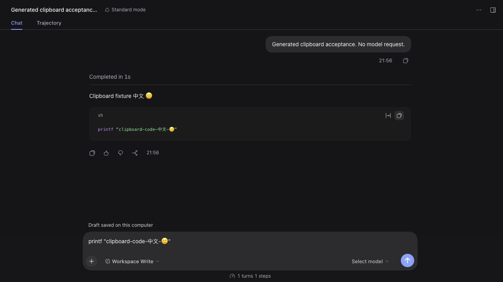

# Actual web copy/paste acceptance

Code commit `f97f7fd5750510746454d20282b3c62aef5e1f6c`, exact candidate archive `a9f82b7230b0791b73edc218244d971182a6e2c2702ac1392d6853a689c58ff3`.

Using the actual installed plugin and DSH 0.2.1-rc.2 Client, the corrected generated six-event history rendered a reply and shell code block without a projection error. Clicking the code-block copy button, then pasting into the composer, produced `printf "clipboard-code-中文-🙂"`. Copying the whole reply retained its Chinese, emoji, paragraph break and Markdown code fences. A generated canary was placed first; the original clipboard was not read. No message was submitted or model requested.

The composer was cleared afterward and the installed gateway confirmed a persisted empty draft. Both generated local and remote controllers were stopped after canonical process ownership checks. The reusable generated SSH listener was preserved. `web.json` records these checks; `provenance.json` includes the screenshot hash.

This is **web Client acceptance**, not the final Desktop browser-guest permission/focus test or native archive/reopen acceptance. The Mac remained locked. The native performance, memory-release and final-candidate 24-hour gates remain open.

The same code commit's [CI 39901430310](https://github.com/Biogod2020/dsh-ssh/actions/runs/39901430310) completed all three verification gates successfully; publishing and installation jobs were skipped on the development branch. `ci.json` records terminal status. These results do not mean npm or the daily installation was updated.
