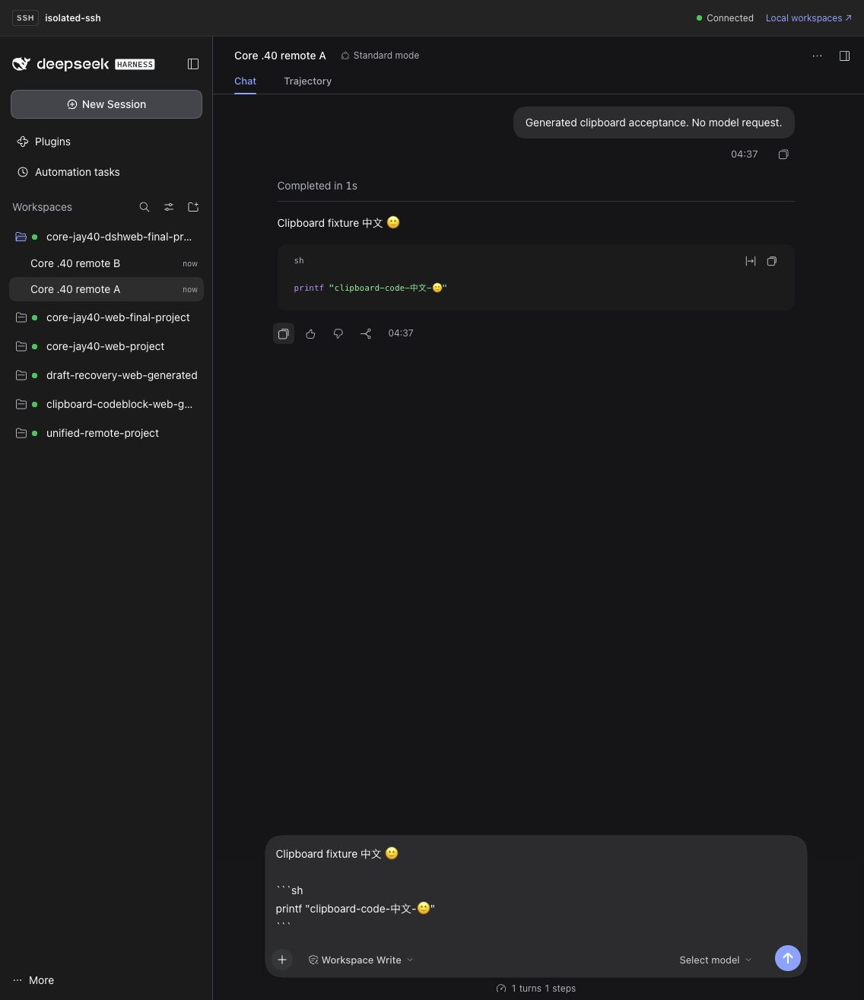
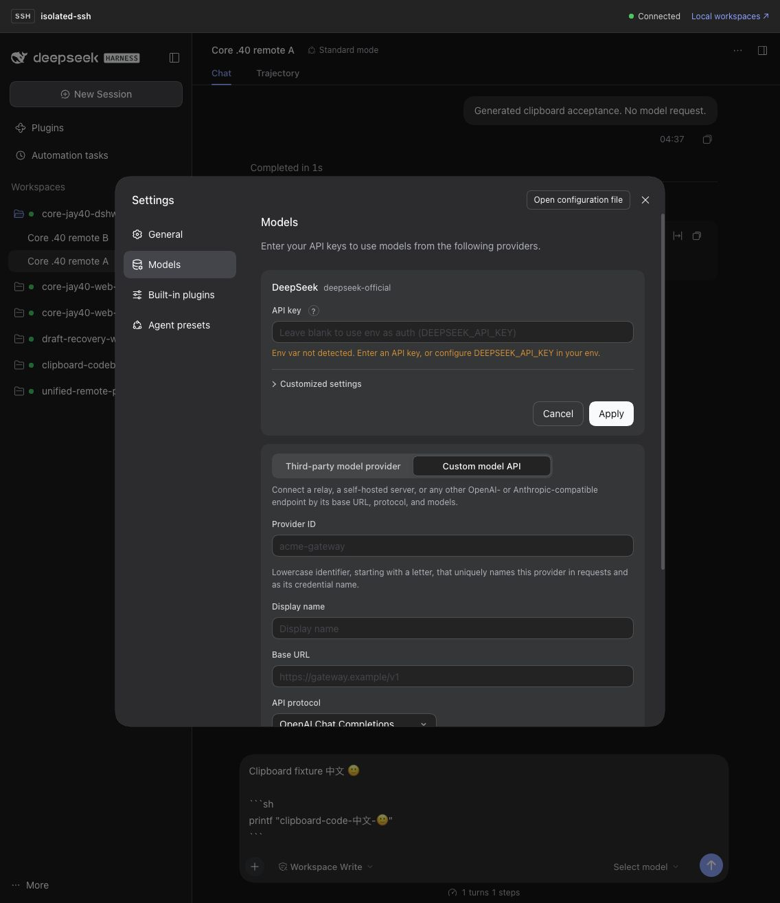
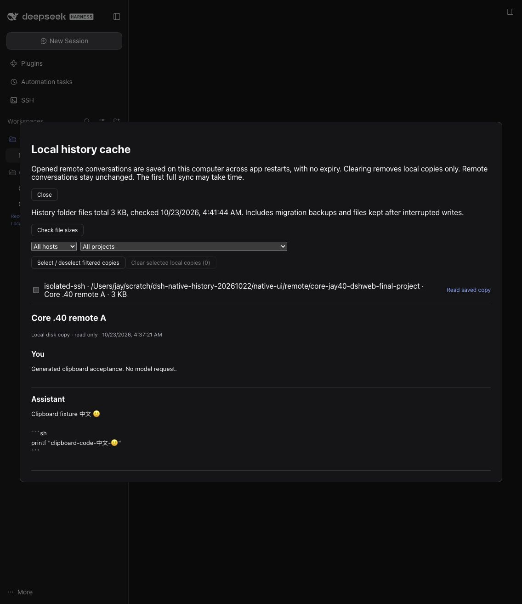
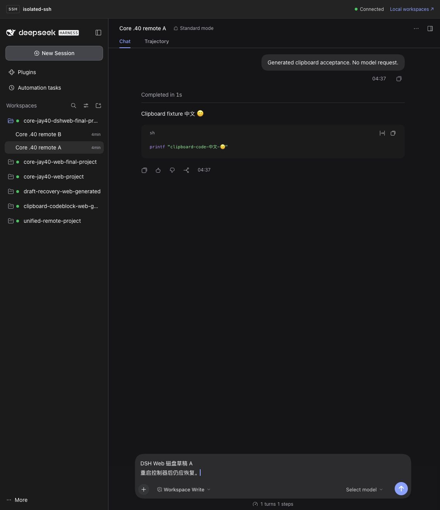

# Actual dsh web core acceptance — 2026-10-23

Launched the official DSH 0.2.1-rc.2 Node CLI with `dsh web`, in a private disposable Home with generated SSH identities, sessions and messages. All interactions used the Codex built-in browser. No Desktop App was operated and no model generation request was sent.

Fixed a real login failure: a controller opened as `localhost` issued remote launch links on `127.0.0.1`, making the browser mark the redirect cross-site. The gateway now preserves the authenticated controller request's loopback hostname. Tickets and cookies bind to the exact gateway origin; wrong-origin reuse and cross-site requests remain rejected. The return-to-local link uses that same hostname.

The actual installed candidate matched all three JS files and 103 source files in the tested archive. [Acceptance provenance](acceptance.json) records its hash; the release workflow rebuilds from the final commit, so the published archive hash is recorded separately.

- Code-block and full-reply copy/paste preserved Chinese, emoji, paragraphs and code fences.
- Switching A → B → A retained separate drafts. Returning to the local controller restored its own draft.
- Account → Settings → Models → Add model provider → Custom model API opened on the remote Host. This round checked the real form without saving credentials or sending model requests.
- The gateway's embedded Client contribution was rendered in the same browser to save actual editor input through the plugin's disk-draft store. After the local controller stopped and restarted, the ordinary remote Web editor restored that text on a new gateway port. This is Web verification of the shared contribution, not a fresh Desktop test.
- Before reconnecting SSH after restart, the local history dialog read the saved conversation from disk. Reopening the remote row reconnected normally, with the original remote PID/start time preserved.
- The same installed archive also passed [real SSH history acceptance](history-acceptance.json): 1,100 generated messages, one-event delta, selective local clear, controller restart and draft persistence.

The Web controller sidebar groups local and remote projects; remote conversations open in the same browser tab, with a link back to local workspaces. The Desktop-specific retained outer sidebar and its model shortcut are not claimed as new Web behavior. Desktop-only native window interaction and automatic view eviction are outside this round.

