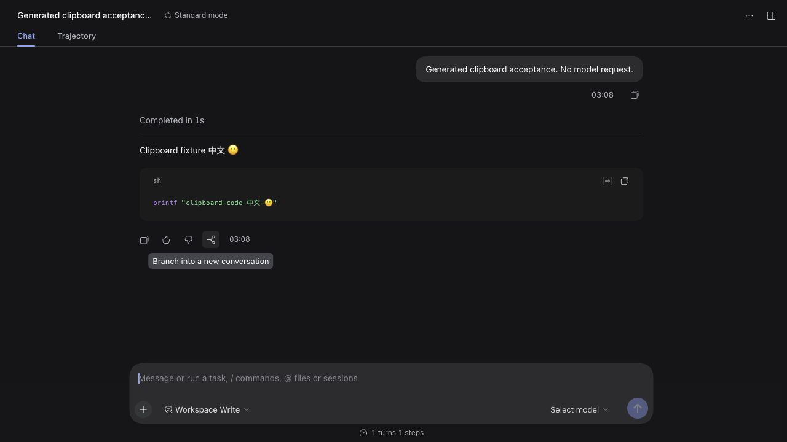

# Logical streams and incoming user answers

Exact private candidate SHA-256: `fa80e4e74f8b98c4acbf7943743b8435322e17f17e91b5cd47d9f71b3c485c6b`. The occupied jay.39 version is a test identity, not a new npm publication.

- [Provenance](logical-observation-final-provenance.json): 103 source files byte matched; 100 test files / 933 tests, typecheck, build, artifact and portable pure-JS pack passed.
- [Actual rc.2 Gateway contract](operation-stream-contract-verified-final.json): unmodified SDK Gateway/Connection in real Cordis, with generated HTTP, WebSocket and user-handler mocks. A persistent `$events` subscription is separate from an active question. The observer waits for validated reply acknowledgement and actual SDK handler/owned Context cleanup. A cancelled handler that ignores its signal remains protected until it settles; the SDK sends no cancelled answer. Logical items/end and original method descriptors survive observation/cleanup. Source hashes are recorded.
- [Actual rc.2 unary contract](logical-observation-final-rpc-contract.json): delayed JSON and binary decoding, correlation mismatch, abort, validated business refusal and parallel out-of-order completion retain their contracts. A business refusal is a known response, not proof of business success; it must not become an unknown-outcome notice.
- [rc.2](logical-observation-final-runtime-rc21.json), [0.2.0-rc.2](logical-observation-final-runtime-rc20.json), [alpha.4](logical-observation-final-runtime-alpha4.json): the same installed archive passes SSH/catalog baseline and exact served bootstrap/contribution execution in a **mock** Client. These cover serialization/field boundaries, not complete observation in a real renderer. The implementation-seam contract above is specifically rc.2.
- [Published jay.39 downgrade](logical-observation-final-downgrade.json): all 603 expected events and clear fences survive export/install.
- [Real web Client regression](logical-observation-final-web-regression.json): a fresh private Home has all three installed JS files matched to this archive. CUA observed valid generated history, then created/selected a new branch. Full AX and original JPEG evidence were saved; the temporary tab and owned local controller were closed. The same generated remote PID and OS birth time survived. Internal live counters, native UI and release-barrier acceptance were **not** inspected or claimed.
- [Previous 806a174 CI](prior-806a174-ci-status.json) completed all three gates. This proves the preceding unary commit, not the new changes; their next full CI must be checked separately.

No generation-model tasks were sent. Daily profiles/configuration were untouched. `events.answer` is a guarded implementation seam of the pinned SDK, not an upstream stable API. Unsupported custom/worker composition remains unchanged. Correlation IDs exist only in a bounded closure; inspection/persistence exclude them and request content.

Whole-view pending and unknown counts remain **null**, `fullCoverage=false`, `automaticReleaseEligible=false`. Construction before attachment, unsupported resources, gateway dispatch/freeze and an exact-owner Client acknowledgement/drop barrier still need completion. No automatic memory eviction is enabled; these tests do not replace the native 100 warm / 30 cold matrix or the final candidate's 24-hour run.
