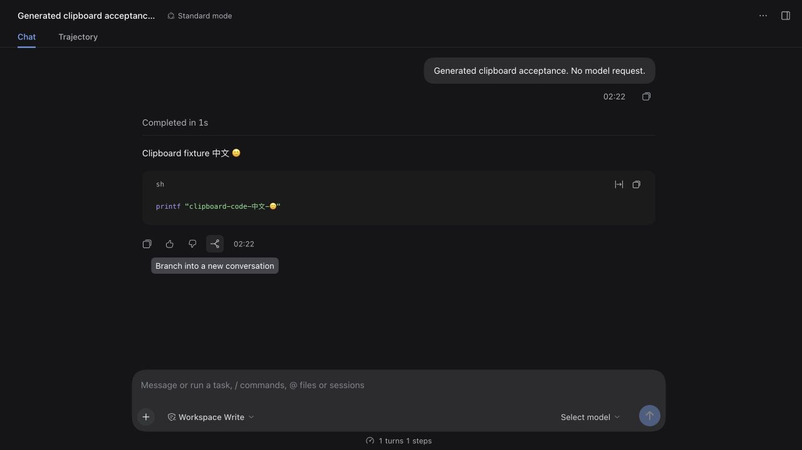

# Scoped unary observation: exact candidate and evidence

SHA-256: `2c5a7346f1a6eee448cb4f8a3842b723dde503423f8bfbd2dfa01dd2074c33b4`. The occupied jay.39 version is used only for private candidate tests.

- [Provenance](provenance.json): 102 source files byte matched; 99 files / 916 tests, typecheck, build, artifact and pure-JS pack passed.
- [Actual SDK contract](unary-observation-verified-rpc-contract.json): unmodified rc.2 SDK with mock Context/HTTP, now using the serialized observer itself. Parallel A/B calls resolve out of order with counts 2 → 1 → 0; delayed binary decoding remains pending. The SDK, ledger and observer source digests are recorded. This does not prove whole-page coverage.
- [rc.2](unary-observation-runtime-rc21.json), [0.2.0-rc.2](unary-observation-runtime-rc20.json), [alpha.4](unary-observation-runtime-alpha4.json): actual installed-plugin/SSH baseline and exact served bootstrap/contribution execution in a **mock** Client. Full-operation observation and native UI remain explicitly unverified.
- [Published jay.39 downgrade](unary-observation-downgrade.json) retains all 603 expected events and clear fences.
- [Real web Client regression](unary-observation-web-regression.json): a fresh private Home has all three installed JS files matched to the archive; CUA observed valid generated history and creation/selection of its branch. The original remote PID and birth time survived controlled local-controller shutdown. Screenshot is original JPEG data; the saved AX evidence is a diff caption, not a complete transcript. This is visible web behavior, not an inspection of hidden counters or native release-barrier acceptance.

No tasks were sent to a generation model. Daily profile unchanged; temporary browser tab and its owned local controller closed. Shared generated remote preserved. Logical streams, incoming questions, gateway freeze, automatic LRU, native latency and final-candidate 24-hour acceptance remain open.

[Behavior and exact scope](../../../operation-release-core-2026-10-23.md).
