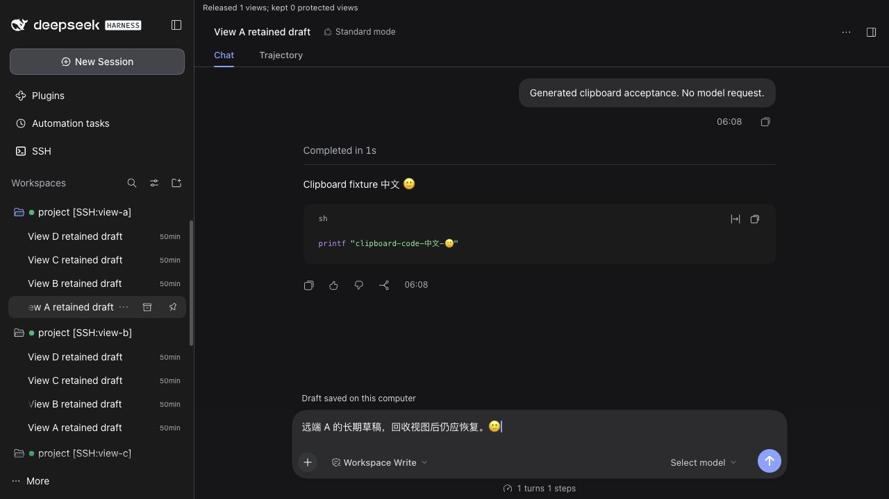
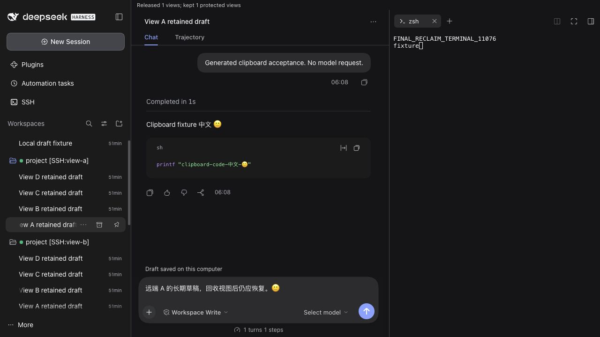

# 闲置视图回收与重复请求优化 — jay.41

远端历史和草稿保存在本机磁盘，回收的是后台渲染视图。重新打开时先读已保存内容，再连接远端补齐变化。视图回收不会清除本地历史，也不会停止远端 DSH 服务。

## 实际行为

- 普通视图保留上限为 3 个；后台闲置 5 分钟、打开更多主机，或 JavaScript 堆估计超过 512 MiB 时尝试回收。每 30 秒检查一次，也可以在会话菜单选择“释放闲置视图”。
- 当前视图、带终端或文件标签的视图、未落盘的草稿、附件/引用、待确认操作和运行中的任务受到保护。保护条件成立时可以超出普通视图预算；不会为了控制数量关闭终端。
- 草稿先写入磁盘，再冻结客户端和网关的发送；只有两端确认安全，才删除该视图。重新选择正在回收的会话会等本次释放结束，再从保存的数据恢复。
- `dsh web` 现在和 Desktop 共用保留外层侧栏的视图管理。Web 使用隔离来源的 iframe 与固定消息协议；Desktop 继续使用已有官方 guest 接口。
- 安静主机的会话目录在 15 秒内复用；有运行任务时保持 2 秒刷新。创建、重命名等操作和远端目录推送立即使缓存失效。同一主机的多个项目共享一次目录读取。
- 已有工作区重开通过只读目录验证归属，不再重复发送 `workspace/create`。成功健康检查合并并短暂复用，隐藏视图停止重复轮询。

512 MiB 是浏览器给出的 JavaScript 堆估计预算，不是进程 RSS，也不据此宣称释放了某个精确的物理内存数量。消息事件仍使用已有的磁盘增量同步；目录元数据不是所有情况下都具有增量接口。

## 内置浏览器实际验收

正式归档安装到隔离 DSH 0.2.1-rc.2 的 Web profile，核对三个运行时 JS 与归档字节一致，并确认没有使用开发目录链接。测试使用生成的 SSH 密钥、会话和消息：四个逻辑主机别名连接同一台回环 SSH 服务器，不代表四台物理服务器。没有操作 Desktop App，也没有调用模型生成内容。

| 实际操作 | 观察结果 |
| --- | --- |
| A → B，释放闲置视图 | iframe 从 2 个降为 1 个，提示释放 1 个视图 |
| 重新打开 A | 原历史与中文、emoji 草稿恢复 |
| A 创建真实终端，再切换 B 释放 | 提示保留 1 个受保护视图，A 未删除 |
| 连续打开 C、D | 自动释放可回收视图，保留 A 终端与当前 D；返回 A 仍是原 shell PID |
| 安静主机重命名会话 | 侧栏和会话标题立即更新 |
| 消息复制 | 真实复制内容保留中文、emoji 和代码围栏 |
| 控制器停止、重启后尚未连 SSH | 从本地历史管理器读到保存的完整测试对话 |

[机器可读验收来源](benchmarks/2026-10-23/idle-views/acceptance.json)。本机正式候选通过 102 个文件、947 项测试、类型检查、构建、归档检查和 DSH 0.2.1-rc.2 隔离运行。CI 另对三个支持的 DSH 运行时、历史补差/重启/回退和 SSH 断线执行发行验收。

## Gemini 协作复核

按用户指定通过 CLIProxyAPI 调用 Gemini 3.8 Flash：请求别名 `gemini-3.8-flash-high`，服务返回 `gemini-3.8-flash-n`。两次有效定向复核分别关注释放顺序和传输边界；超时请求不算完成的复核。

采纳了准备阶段的取消代数检查、提交后必须删除原视图、成功提交清除令牌、先解冻网关再解冻客户端，以及未知流上行数据阻止释放。相关回归与实际终端/草稿路径均通过。

未采纳三项与实现证据不符或会破坏保护的建议：终端流已在冻结入口逐项排除；非 JSON 响应不能在收到响应头时假定内容读取完成；覆盖状态失效只撤销安全证明，不会中断正常客户端启动。保留这些边界，避免把不完整观察误当作可以关闭的证明。

## 已发布版本

[0.3.24-jay.41](https://github.com/Biogod2020/dsh-ssh/releases/tag/v0.3.24-jay.41) 的 [verify、OIDC publish、verify-installation](https://github.com/Biogod2020/dsh-ssh/actions/runs/39966172605) 全部成功。npm 与实际国内镜像 CDN 的归档完整性一致，三个运行时验收和按包名安装通过；macOS 另完成 npm 按包名安装到 DSH 0.2.1-rc.2 的隔离验收。

CI 归档为 1,369,537 字节，SHA-256 `a4c11489e0f2abe31a532bf378c1c71a6599d843e6da694c6d495a24ee5c4ae1`。三个运行时 JS 与 105 个源码文件均与内置浏览器实测的候选包逐字节一致。[公开文件与安装核对结果](benchmarks/2026-10-23/idle-views/published.json)。
