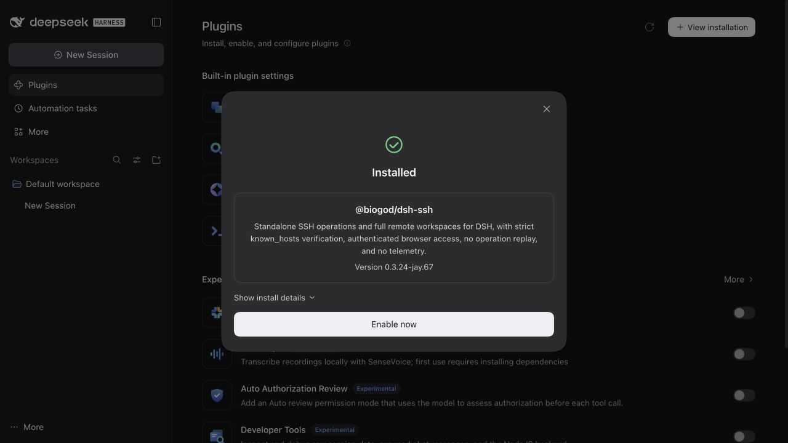

# 配置一次，以后只输入插件包名

在 DSH profile 中信任 `@biogod/dsh-ssh` 的即时更新后，官方 **插件 → 添加插件** 只需输入：

```text
@biogod/dsh-ssh
```

安装器会选择所用 npm 源的 `latest`，不再因为本包的新包等待期选择旧版本。该规则按包名持续生效，以后无需每版改版本号。

## 一次性设置

先备份当前环境的 `pnpm-workspace.yaml`，在原有 `minimumReleaseAgeExclude` 列表中追加这一项；不存在该字段时再新增字段：

```yaml
minimumReleaseAgeExclude:
  - '@biogod/dsh-ssh'
```

默认路径为：

| 使用环境 | 配置文件 |
| --- | --- |
| Desktop | `~/.dsh/profiles/desktop/pnpm-workspace.yaml` |
| Web | `~/.dsh/profiles/web/pnpm-workspace.yaml` |

同时使用 Web 和 Desktop 时分别配置。使用自定义 `DSH_HOME` 时，路径以该环境的实际目录为准。尚未初始化的环境，先启动相应 DSH 环境再配置。

保留列表中已有的其他条目、文件中的其他设置和注释。只加入上面这个完整包名；其他依赖继续使用原来的等待策略。[pnpm 官方配置说明](https://pnpm.io/settings/dependency-resolution#minimumreleaseageexclude)

设置对后续安装即时生效，不需要重启 DSH。它不会自动安装或启用插件。其他账号、机器或独立 profile 需要各配置一次。

## 实际验收

在生成的独立 DSH `0.2.1-rc.3` Web 环境中，先添加上述不含版本号的包名规则，再从官方 **添加插件** 表单仅输入 `@biogod/dsh-ssh`，选择 npm 官方源。最终界面显示安装版本 `0.3.24-jay.67`，安装后的 Host/client 文件与公开发行包字节相同。



这验证的是一次配置后的官方安装入口。完全没有该设置的新用户仍受安装器的等待策略约束；插件在首次安装前无法修改宿主的策略。安装来源的索引和镜像也需要已同步目标版本。
