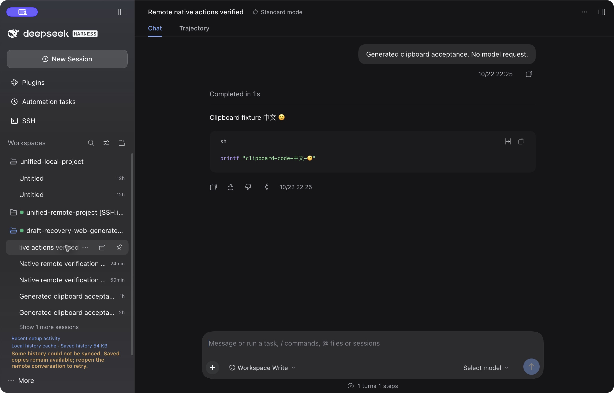
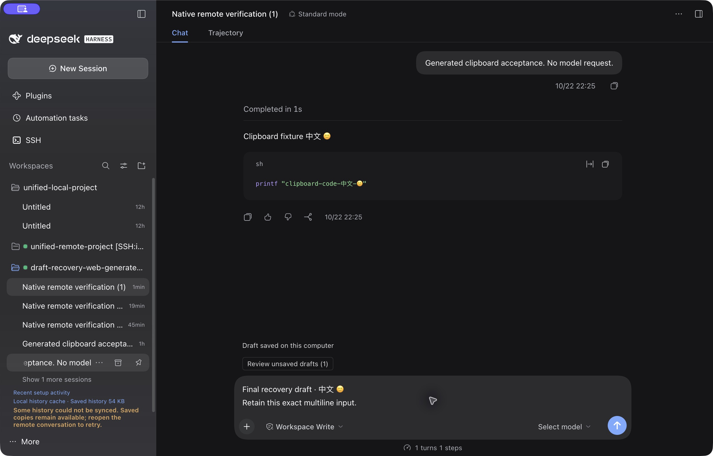
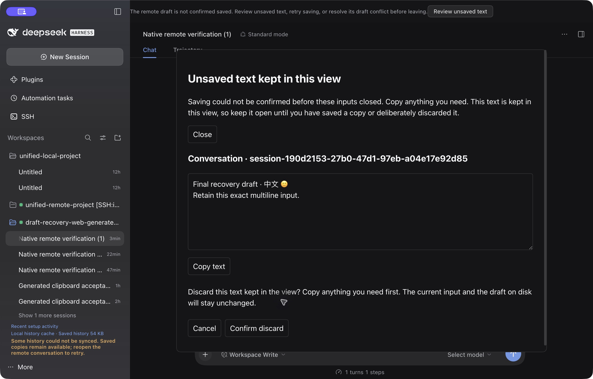

# 远端复制、原生会话动作与未保存草稿恢复

这批候选已在 macOS 原生 DSH `0.2.1-rc.2` 通过实际交互验收：远端行的省略号、归档和置顶按钮可用，菜单可重命名、取消归档并打开同一远端主机的 Models；取消归档后重新点击原会话能显示原来的有效历史。代码块和整条回复的复制粘贴保留中文、emoji、多行及 Markdown。日常安装仍未替换。

图中全部主机、项目和消息来自隔离夹具，没有调用模型。橙色提示来自同一夹具中更早的手写无效历史；这些旧测试记录保留，不能把它们算作成功同步。当前图中的六事件历史由修正后的生成器创建，实际原生渲染和重新打开均通过。

## 保存失败也能找回文字

原来的失败路径是：输入框关闭时保存失败，旧 Replica 被保留，但视图关闭只检查当前输入，可能丢失上一会话的未确认文字。现在保存失败后只保留文字和引用/附件存在标记，不保留旧编辑器、附件句柄或 Context 图。普通同页切换仍可继续；真正离开或销毁视图要等待正在收尾的保存，并拒绝尚未处理的失败记录。

恢复入口与聊天输入框对齐，也可从父视图的“查看未保存文字”打开。每次查看一份，支持复制、前后翻页和明确丢弃。复制不会冒充磁盘持久化，也不会清除关闭保护。空内容明确表示一次尚未确认的清空。相同 Host/Session 的准确文字与资源标记成功保存后会自动解除对应保护；不同会话的新草稿不会替代它。

原生测试只将生成的本机草稿目录临时设为不可写，实际触发保存失败、创建分支、查看旧文字、尝试关闭视图并观察拒绝。恢复写权限后，将旧文字复制到另一个会话并确认保存；旧失败记录仍受保护。随后取消和确认丢弃均走通，确认只移除被选中的旧快照，新编辑器和磁盘原记录不变。目录权限恢复为 0700，远端进程 PID 与启动时间没有变化。

## 两个只在原生嵌入页暴露的问题

1. `dialog.showModal()` 让弹窗外内容进入 inert 状态。旧复制兼容层把临时 textarea 放在 body 中，无法取得焦点，却可能仅凭 `execCommand` 的 true 误报成功。现在把临时字段放在当前焦点所属的打开 dialog 中，并同时检查字段取得焦点、copy 事件确实填入文本以及命令结果。否则保留原 API 的成功/拒绝，不读剪贴板，不增加权限或 IPC。复制进行中使用独立防重标记与 aria-disabled，保留键盘焦点。
2. 官方 Desktop guest 明确配置 `disableDialogs: true`，所以 `window.confirm()` 不适用于此恢复面板。改为面板内两步确认，默认聚焦“取消”，取消后回到丢弃按钮；最终动作再次核对快照与面板身份，不写磁盘或远端。

同时修正了保存/读取完成时的订阅通知和 React StrictMode 立即释放/重获同一 Replica 的生命周期，真实 React 回归验证自动保存完成会自行移除旧失败入口。

## 验证与安装来源

最终代码候选归档 SHA-256 为 `a5791380f6b4540800afa9b31984cd3e4a6df429469c276fd25e456f4ab9f148`。97 文件 / **887 项**、typecheck、build、产物与纯 JS 打包检查通过。相同归档通过三个实际 DSH/SSH 运行时和已发布旧 `.39` 的历史回退。[原始结果与范围](benchmarks/2026-10-23/native-recovery/README.md)。

验收期间曾发现隔离 profile 的依赖记录已指向新 tarball，但 node_modules 仍链接到旧开发目录。源码一致无法证明实际 JS 一致，因此先前仅按源码校验的原生结果作废。正常退出隔离应用后，仅移除并重新添加该测试插件，保留其他依赖、启用配置、测试会话及主机数据；再逐字节核对 desktop/web 各三份实际 JS，并重新完成本页最终包的原生交互。日常 profile 不受影响。

早期草稿候选的一次全量运行有两个原安装器 5 秒超时；保留失败记录，相同源码的专项和全量复验通过，没有放宽阈值。最终原生修正包的完整 887 项运行直接通过。

实际 Gemini 审阅 `ou7aaqbQGqbhytMPxvPCwAc`、`JgvbasiSGryF1sgPzu7ZmQ0` 和 `HQ3bao7sDLeJwbUP2O2MgAo`。请求模型 gemini-3.8-flash-high，服务返回 gemini-3.8-flash-n。已采纳实际保存通知、StrictMode、复制按钮失焦和确认焦点问题；未采用“DOM 最后一个 dialog 必然是顶层 modal”及“字段聚焦百分之百成功”等推断，仍检查实际焦点和事件结果。

这批结果不代表整体里程碑已经发布：操作观察与原子视图释放、内存预算、100 次暖切换/30 次冷打开的原生延迟及焦点/休眠矩阵、最终稳定候选的 24 小时验收仍待完成。候选沿用已占用 `.39` 只供隔离测试，不覆盖 npm 同版本；正式发布仍执行独立版本、全部门槛、OIDC、镜像和安装校验。
