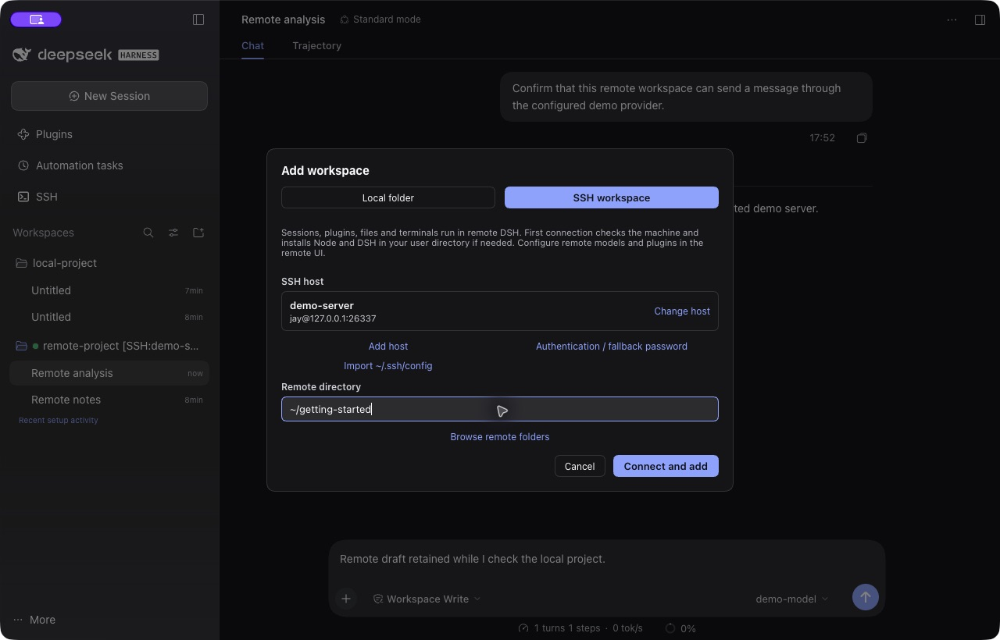
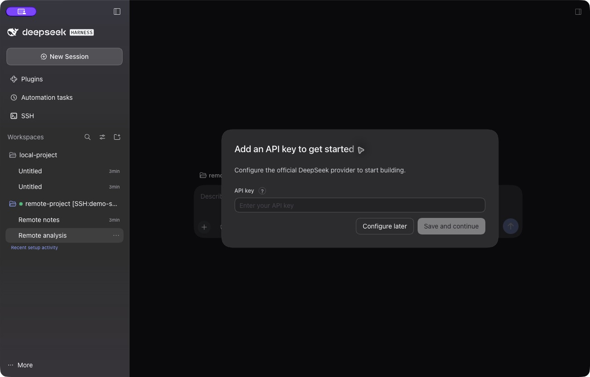
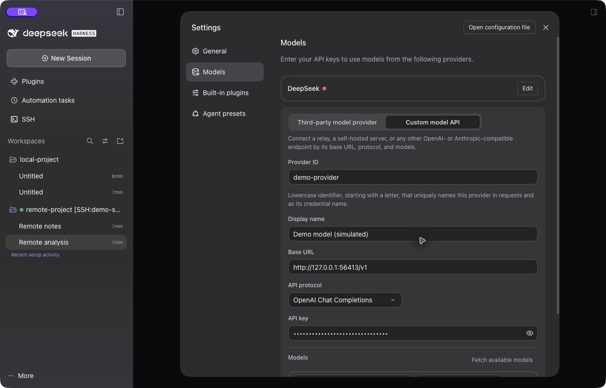

# 桌面版首次使用与远端模型配置

本指南的实际界面验收环境是 macOS arm64、DSH Desktop `0.2.1-rc.2`、远端 DSH `0.2.1-rc.2` 和已发布的 `@biogod/dsh-ssh@0.3.24-jay.34`。使用独立 HOME、DSH_HOME、浏览器数据目录和生成的 loopback SSH 密钥，没有使用日常主机、会话或模型凭据。

远端自动安装缺失 DSH 时仍默认固定 `0.2.1-alpha.4`，不是本指南为截图而更改了安装器。其他受支持版本的最终包验收见 [verification.md](verification.md)；这里不把 macOS 的实拍操作声称为所有平台已逐一重跑。

## 从安装到打开项目

1. 桌面 DSH 左侧 **Plugins / 插件 → Add plugin / 添加插件**，安装 `@biogod/dsh-ssh@0.3.24-jay.34`，启用。更新已有安装时先保存草稿，再完全退出和重开应用。
2. 打开左侧 **SSH → Hosts**，添加主机，或主动导入 `~/.ssh/config`。检查地址、用户、端口、认证及跳板。
3. 首次连接前，向可信来源核对目标及每层跳板机指纹，再在系统终端用相同 SSH 配置建立 `known_hosts` 信任。例如 `ssh your-host-alias`，请替换别名；不要跳过指纹核验。插件不会弹窗代你接受未知密钥。
4. **Add workspace → SSH workspace**，搜索主机并选择，输入远端项目目录，例如 `~/projects/my-project`，点击 **Connect and add**。缺失依赖时远端需具备下载网络和可写用户目录；不需要 sudo。
5. 等待进度完成。选择 **Continue in background** 后不会自动切走当前页面，可稍后从侧栏打开已经准备好的项目。

这次实测使用生成的 `demo-server` 主机与 `~/getting-started` 测试目录。点击 **Connect and add** 后，该目录实际出现在统一侧栏，打开远端新会话；同一主机的已有远端页面继续复用。

## 远端模型配置入口

远端工作区是一套独立 DSH。本机开发版默认通过 SSH 同步可直接访问的 API 模型配置和 API Key。在 **SSH → 服务器模型** 中，可按整台主机、提供方或默认模型选择跟随本机或独立配置；远端已有认证和手动修改会受到保护。网页登录、Cookie 和本机回环代理不会直接复制。插件通过服务器插件页单独管理。

以下手动配置步骤适用于独立配置、无法同步的认证方式，以及尚未支持模型同步的旧版本。

首次进入空的远端环境时会显示 **Get started**。使用官方 DeepSeek API 时，选择 **Add API Key**，填入自己的 Key 并 **Save and continue**。准备使用其他模型提供方时，可先 **Configure later**，然后进入 Models。

### macOS 已验证的设置路径

1. 在外侧统一侧栏打开远端项目或会话。
2. 点击一次**右侧远端聊天输入框**，使键盘焦点位于远端页面。
3. 按 **Command + Option + 逗号**，即 `⌘⌥,`。
4. 在打开的远端设置中选择 **Models**。

**`⌘,` 打开本机设置；`⌘⌥,` 在远端页面获得焦点时打开远端设置。** 即使外侧侧栏仍然可见，两套设置也属于不同的 Host。远端重复侧栏被隐藏，不需要为配置模型另开一个窗口。

DSH Web 客户端的默认 Windows 绑定在当前接口中为 `Ctrl+Alt+,`，本轮没有在 Windows 实机验收。自定义过快捷键的环境应以该客户端的 Keyboard shortcuts 为准，不将本机设置快捷键直接当作远端快捷键。

### 添加自定义模型 API

1. **Models → Add model provider → Custom model API**。
2. 填写唯一的 **Provider ID**、便于识别的 **Display name**、服务要求的 **Base URL**，选择与接口匹配的 **API protocol**，填写自己的认证信息。
3. 点击 **Fetch available models → Add selected**；服务不支持模型发现时，使用 **Add model** 填入实际模型 ID。至少添加一个模型后再 **Create provider**。
4. 关闭远端设置，打开聊天输入框里的模型选择器，选择新模型。
5. 发送一条简短消息，确认收到回复，再开始实际任务。

本轮实际配置的是 **OpenAI Chat Completions** 协议的隔离模拟服务：Models 列表发现成功，模型出现在选择器中，用户消息经远端 DSH 发出，界面收到明确标注为 simulated 的固定回复。服务记录到 **1 次** `/v1/chat/completions` 请求；这验证消息链路，不验证真实模型质量、计费或推理速度。

配置检查确认 `demo-provider` 写入远端 profile，本机 profile 没有该提供方。截图中的 Key 是测试占位符，保持遮盖；地址只在测试环境有效。请勿将其当作可用公共模型服务。

## 网络地址如何填写

Base URL 由远端 DSH 发起访问。比如服务器上的 `http://127.0.0.1:8000/v1` 指该服务器自己的 8000 端口；笔记本上的同名地址不会自动透传。

要使用笔记本提供的模型服务，需要先建立远端可达、经过认证的网络路径。模型中继和本地 Agent/远端执行器属于 [设计建议](execution-modes.md)，当前插件没有自动实现这两种模式。

## 常见卡点

| 看到的情况 | 检查 |
| --- | --- |
| 插件安装后桌面没有 SSH | 在桌面插件页安装并启用，更新后完全退出重开；`--profile web` 命令只装入 Web profile |
| 未知或变化的主机密钥被拒绝 | 先核对指纹，在系统 OpenSSH 建立可信记录；不要通过关闭校验解决 |
| 远端选择器显示 No models available | 确认打开的是远端 Models；提供方至少有一个模型，配置已保存，之后重新打开选择器 |
| 模型配置出现在本机，却没有出现在远端 | 先在 SSH → 服务器模型检查连接、同步状态及是否选择独立配置；需要手动设置时聚焦远端输入框，使用 `⌘⌥,` |
| 模型列表或消息请求连接失败 | 从远端检查服务地址、认证、协议与网络可达性；尤其检查 `127.0.0.1` 的归属 |
| 切换项目后担心丢失草稿 | 普通本地/远端会话切换保留已加载页面的草稿；关闭视图、退出进程与普通切换不同，先保存重要文字 |

## 截图与验收记录

截图由真实应用窗口直接采集，没有重画界面、替换回复或拼接私人数据。图中项目和对话均为演示内容，模拟回复在界面文字及本指南中明确标识。

- [统一侧栏与远端回复](images/unified-sidebar.png)
- [添加 SSH 工作区](images/add-ssh-workspace.png)
- [首次 API Key 引导](images/remote-first-api-key.png)
- [远端自定义模型表单](images/remote-model-provider.png)

实际验收还确认本地与远端往返后保留各自草稿、远端新项目复用同一主机页面、已发送消息没有因切换而再次发送。机器可读摘要及截图 SHA-256 见 [onboarding-acceptance.json](onboarding-acceptance.json)。
