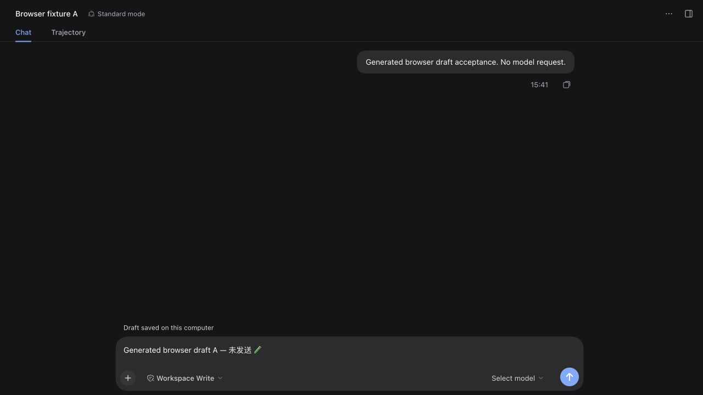
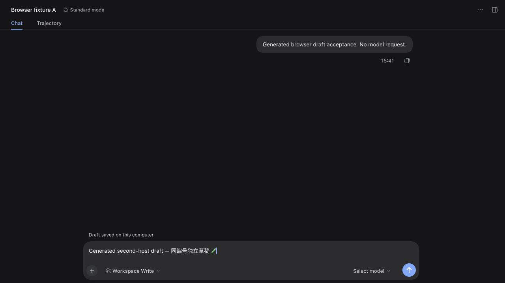
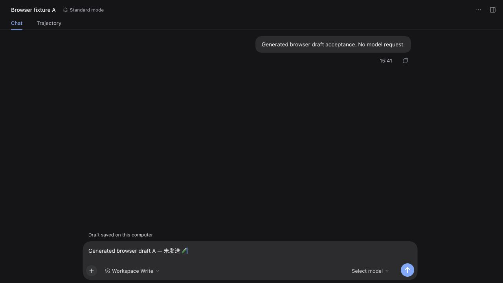

# 真实浏览器草稿与安装包回退验收

候选已通过实际 DSH 0.2.1-rc.2 Web 客户端的草稿保存、跨来源恢复和身份隔离；尚未发布或替换日常安装。Mac 无法打开期间，后台浏览器提供了真实编辑器证据，桌面窗口、菜单、实际休眠和导航分位数仍单独待验收。

## 真实编辑器检查

所有 Home、SSH 密钥、主机配置、会话和文字均由隔离夹具生成。通过 CUA 操作正式客户端的文本输入框，没有发送模型消息。官方公开的 Session input face 和输入槽实际加载并运行，不以模拟 React 或 HTML 种子代替编辑器结果。

- A、B 两条会话分别输入中英文及 emoji，等待界面确认“Draft saved on this computer”，再独立读取本机文件核对。
- 重启本机测试控制器后网关换端口，B 的已确认文字在实际编辑器恢复；远端原 PID 保留。
- 用编辑器正常全选、退格清空 B，独立确认空草稿落盘；再次重启换端口后仍为空、发送按钮禁用，A 的草稿保持不变。
- 重新安装修正后的候选归档，只重启测试控制器，第三次换端口后 A 仍恢复，B 仍为空。保存提示现在使用官方输入框的 `--dsh-composer-card-max-width` 和 `--dsh-composer-side-clearance` 对齐，不依赖 SDK 散列类名或固定屏幕坐标。
- 第二个已配置的逻辑 Host 身份使用相同 Session id，初始输入为空；写入不同草稿后返回第一 Host，原文字仍在。两个私有文件各自核对通过。本项使用同一物理 SSH 端点，验证逻辑 Host 命名空间，不将它宣传成两台实际机器的桌面切换。

测试共经历三次控制器重启。前两次使用空间统计候选，第三次使用布局修正归档 `9d3adc14ca425bea808b0e0c42d32c9aa99fef0acf2e15479cd4677c1153cb6f`。测试仍标记不可发布的 `.39`，不能覆盖 npm 上已有同版本。[结构化结果](benchmarks/2026-10-22/web-client-drafts-macos.json)明确列出原生桌面和实际休眠未验收；测试结束后临时页、控制器和生成的远端进程已退出。

## 实际安装包回退检查

新 `scripts/history-downgrade-smoke.mjs` 从实际归档抽取并运行其导出器及所需源文件。两 Host 使用相同 Session id，种入 600 条旧格式事件，包含超过 2 MiB 的单条输出；迁移后新增三条并更新标题。清理第二 Host 后故意留下生成的旧副本和迁移归档，导出仍只包含保留会话的 603 条完整事件。

检查保留首存时间及其余元数据、全部原始事件和新增事件、清理屏障，以及源历史文件散列；除写入者租约身份外的 control 数据完全不变。活跃写入者被拒绝、其锁字节不变；目标已存在时拒绝覆盖，退出后没有残留导出器锁。它不自动恢复旧目录，不连接 SSH，不请求模型。

随后在另一个私有 Home 安装 npm 上真实发布的 `.39`，用 DSH 0.2.1-rc.2 启动，实际 API 读回同一份 603 条导出，第二 Host 的已清理副本不存在，连接列表为空。[原始结果](benchmarks/2026-10-22/packaged-downgrade-macos.json)保留归档及导出器 SHA-256。旧版下载固定官方 URL 和 SHA-256 `0aa53cabb1714fbdee68946efa7394b9efabc079c1017de07ce0a5646c26b1ec`。

该检查已接入发布工作流，旧包放在 `release/` 之外，避免污染“唯一待发布归档”的选择。GitHub 分支检查不会发布 npm；最终版本仍须另分配版本并跑完整发行门槛。

## Gemini 定向复核与独立判断

实际请求 `gemini-3.8-flash-high`，服务返回 `gemini-3.8-flash-n`，响应 `uZTaaoywPIyEuMYPnLnjoAw`。采纳补查 control 非租约字段、残留锁和子进程退出期限；若退出无法确认则失败，不把超时直接当成功。未采纳“官方下载已经重定向”及“抽取的实际依赖缺失”的无证据判断；固定哈希下载和实际旧运行时均独立通过。缓存散列不符继续拒绝，不悄悄替换未知文件。

本轮布局候选的 `release:local` 通过 86 文件 / 777 项、typecheck、build、产物和可移植归档检查。此前 [`1c07161` 完整 CI](https://github.com/Biogod2020/dsh-ssh/actions/runs/39863480425)的三个门槛均通过，包含三个运行时安装、普通网络矩阵和独立 1% 内核丢包；其[原始测量](benchmarks/2026-10-22/ci-1c07161/README.md)单独归档，不能算作后续布局和新 CI 步骤已执行。
